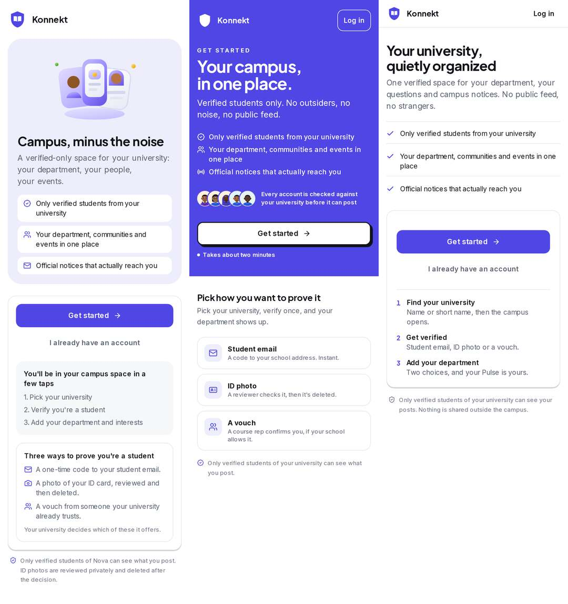
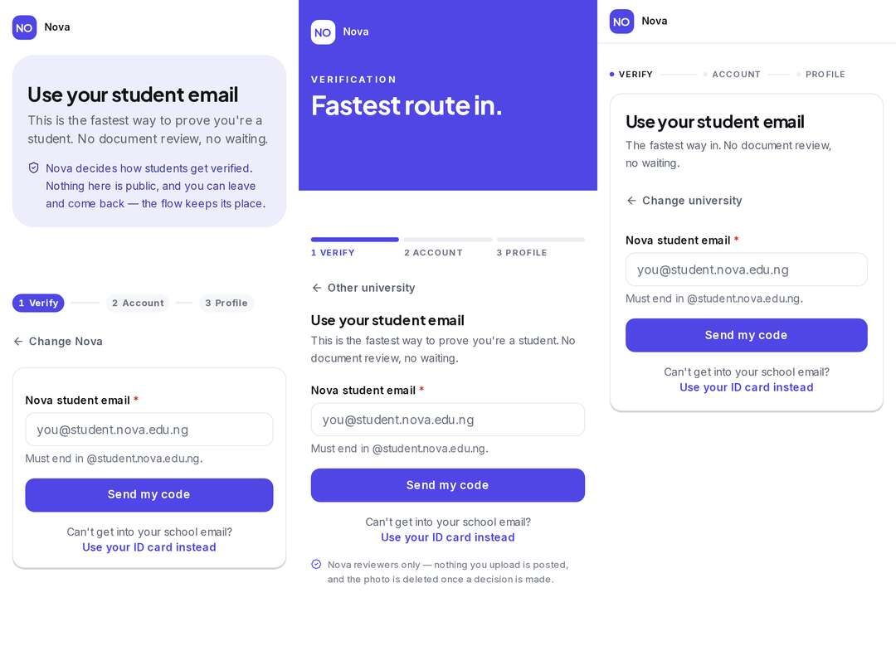
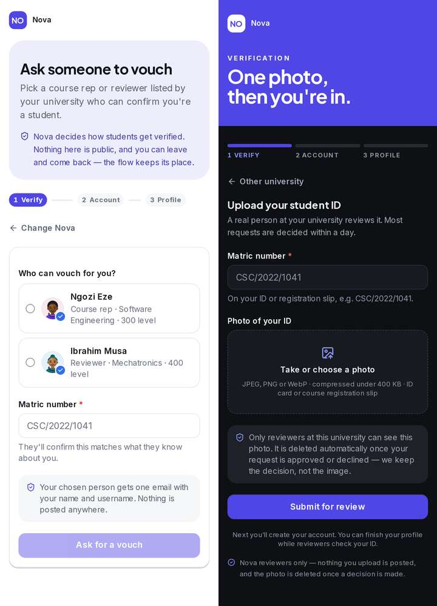
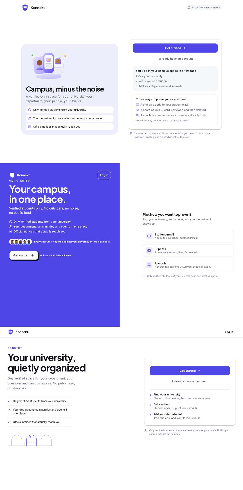

# Auth flow — three visual directions (dev-only preview)

Branch `ui/auth-directions`. This is a **design exploration**, not a routing change: three complete
treatments of every sign-up / sign-in screen, rendered side by side so the direction can be picked
before anyone styles the live flow. No live route, form component, action, schema or test file was
touched — `git diff --stat origin/main...HEAD` is 28 paths / 2,275 insertions / zero deletions: 18 new files under
`src/components/auth/directions/**` and `src/app/design/auth-{a,b,c,directions}/`, one added link in
`src/app/design/page.tsx`, and this folder (9 files, 616 KB of JPGs).

## Why a preview harness instead of screenshotting the live screens

`prisma generate` cannot download its query engines in this sandbox (`binaries.prisma.sh` is
network-blocked), so every Prisma-backed route returns 500 — `/signup`, `/login` and the live
`/reset-password` were never renderable here. Rather than stub a route, the frames render **the real
components** (`UniversityPicker`, `StudentEmailForm`, `IdCardForm`, `VouchForm`, `AccountForm`,
`SignupCodeForm`, `LoginForm`, `ForgotPasswordForm`, `ResetPasswordForm`, plus the onboarding fields)
against fixture data, inside a direction. What you review is the actual form UI in an actual frame,
which is also the point of the exercise: a direction only counts if the real form survives inside it.

Two structural decisions came out of that constraint:

* **The frames are server components.** Wrapping the reused forms in a `"use client"` tree looked
  harmless and broke their server-action binding (`Event handlers cannot be passed to Client
  Component props`, 500 on three screens, caught only by walking all 13 steps in a browser). Only the
  toolbar (`preview-controls.tsx`) and the postgraduate `Switch` (`preview-toggle.tsx`) are client
  islands.
* **The accent can change per university.** `accentCssVars()` from `src/lib/domain/color.ts` drives
  `--accent*`, so each direction is reviewed under Nova indigo, Riddy green, Ukas orange and the
  FUPREMT-warri long-name fixture — and every derived surface stays legible because it derives from
  the same tokens the live app uses.

## What's here

| Path | Purpose |
| --- | --- |
| `directions/steps.ts` | The 13 steps every direction must cover, with `group` (Verify → Account → Profile) and `branded` (does a university exist yet). |
| `directions/fixtures.ts` | Four `DirectionUniversity` fixtures, voucher list typed as the real `Voucher`, department/level/interest options. No DB access. |
| `directions/screens.tsx` | Maps a step to the real form component; renders a labelled "method closed" empty state when a fixture disables that route. |
| `directions/brand-slot.tsx` | One brand slot, two states (platform wordmark ↔ university logo/monogram + name), accent-aware in both directions of contrast. |
| `directions/frame-parts.tsx` | `ScreenState` (ok / loading / error / offline) — skeleton, offline card, retry. |
| `directions/direction-a.tsx` | Direction A — Quiet Campus. |
| `directions/direction-b.tsx` | Direction B — Bold Youth. |
| `directions/direction-c.tsx` | Direction C — Premium Minimal. |
| `directions/onboarding-fields.tsx` | Department / Level / postgraduate switch / Bio and the interest chips, declared once and wrapped by each direction. |
| `directions/harness.tsx` + `preview-controls.tsx` + `preview-toggle.tsx` | Query normalisation, accent vars, `<main id="main">`, dev toolbar. |
| `directions/directions.css` | Preview-only, scoped to `.auth-dir`. See "Residual issues" below. |
| `src/app/design/auth-{a,b,c}/page.tsx` | Routes. `notFound()` in production, so this can never ship a preview. |
| `src/app/design/auth-directions/page.tsx` | The rationale write-up (same content as below, next to the frames). |

## The three directions

**A — Quiet Campus.** Tinted panel (`--accent-soft`) carrying the promise, one raised card for the
form, a pill step rail, icon method cards. Copy is plain and unhurried; the trust line sits inside
the tint, not under every card. *Strengths:* closest to today's `surface-card` language, cheapest to
implement, safest for long field lists. *Risk:* reads as "nice product", not distinctive.

**B — Bold Youth.** A full accent block that owns the left half (full-bleed on phones), display type
at `clamp(2rem…3.25rem)`, numbered method rows, one `neo-brutal` primary action **only on Welcome**
(as `docs/UI-CONVENTIONS.md` requires), an avatar cluster as social proof. The form column stays
plain so nothing competes with the colour. *Strengths:* most memorable, best empty-state energy,
works hard for a first impression. *Risk:* the accent block is loud against a university's own
orange or green; the eyebrow is the only place that names the stage, so it is derived from
`stepGroup()` rather than written per screen.

**C — Premium Minimal.** `glass` sticky header, one bordered card with `shadow-raised`, a dot
stepper, hairline dividers, a divide-y method list. Almost no colour except the CTA and the accent
numerals. *Strengths:* calmest, most "official", survives any university palette. *Risk:* at 320px
the card edges crowd the viewport and the low colour contrast between sections needs the shadow to
do structural work.

## Rules all three obey

* **Field parity, no inventions.** Every input, label, helper and CTA label mirrors the live forms —
  `getByLabel("Matric number")` and `("Password")` stay unique, protected strings (`Send my code`,
  `Verify my student email`, `Submit for review`, `Create account`, `Log in`, `Continue to
  communities`, …) are used verbatim.
* **One privacy promise per screen**, phrased for what that step actually asks (B/C/A all suppress
  the ID-review sentence on steps where nothing is uploaded).
* **Tokens only** — `bg-accent / text-accent-fg / border-border / shadow-raised / rounded-card` —
  and **no slash-opacity**: `bg-accent-soft/70` compiles to a no-op here because the token colours
  are bare `var()`s, which is how three invisible panels survived two review passes. Use a solid
  token or `color-mix(in srgb, …)`.
* **Layout hygiene**: base `grid-cols-[minmax(0,1fr)]` plus per-breakpoint `minmax(0,…)` columns,
  `min-w-0` on every wide child, `min-width:0` on inputs and truncated text. Fixed two-column
  fr-tracks were the cause of all 10 horizontal-scroll failures found earlier.
* **Motion**: colour transitions only. The two transforms that exist (B's assurance-row lift, C's
  arrow nudge) are both behind `motion-safe:`, so `prefers-reduced-motion` removes the movement
  rather than leaving a floating card. The dev-only warning that fired while the B lift was
  unguarded is the same class of problem `docs/UI-CONVENTIONS.md` warns about.
* **States and data branches are first-class**: `?state=loading|error|offline`, and a fixture with
  `idCardEnabled: false` / `vouchingEnabled: false` renders the "method closed" empty state instead
  of pretending the route exists.

## Review shots

All images are **labelled fixtures** (dev-only `/design/auth-*` routes, no database), captured in
headless Chromium at 2× on phones.

| 390px, light — Welcome | Choose a verification method | The same real form, three frames |
| --- | --- | --- |
|  |  |  |

| A / B / C in dark | error (A) · offline (B) · loading (C) | method closed by fixture: vouching off (Riddy), ID upload off (Ukas) |
| --- | --- | --- |
|  |  |  |

| 320px with a 46-character university name (FUPREMT Warri) | 1280px desktop, A over B over C |
| --- | --- |
|  |  |

8 JPGs, 616 KB total, in this folder only — deliberately **not** in `design/review/`, which is
`npm run shots`' output directory for live screens and is not modified here.

## How it was verified

`node /tmp/auth-audit.mjs` (Chromium 1445 from `~/chrome`; Playwright's own browser download is
network-blocked): 3 directions × 13 steps × 2 themes = **78 page loads**, each measured at several
widths, per-pass offenders written to `/home/user/shots-auth/meta-*.json` + `problems-auth.json`
with 400 PNGs beside them.

Final sweep on this branch (`WIDTHS=390,1280`, both themes, 156 passes) — **`{"loaded": 78,
"problems": 0, "counts": {}}`**. The wide sweep (`WIDTHS=320,390,768,1280,1920`, 390 passes)
reporting per-check numbers, all against the same fixture set:

| Check | Result |
| --- | --- |
| Text contrast (WCAG AA, background resolved through alpha **and** `color-mix(in srgb …)`) | **0 offenders / 390** |
| Horizontal overflow (`document.scrollWidth > innerWidth`) | **0 / 390** |
| Elements wider than the viewport (excluding the off-screen `a.skip-link`) | **0 / 390** |
| Interactive targets below 44×44 | **0 / 390** |
| Clipped text (`.sr-only` and scroll containers excluded) | **0 / 390** |
| Exactly one visible `h1` | **390 / 390** |
| Page errors | **0** |

On top of that, `curl` against **312 URL variants** (78 fixtures × `u=nova|riddy|ukas|long` ×
`state=ok|error|offline` × `chrome=0|1` × both themes) returned **200 for every one, zero failures** —
that is what caught the one class of bug no type checker sees: a client-only event handler passed
from a server component 500s at runtime, not at build time.

Progression of real defects across the session: 379 → 194 (65 contrast / 60 small targets / 10
hscroll) → 58 → 0. Contrast failures came from an `srgb()` channel parser in the auditor itself;
small targets from bare `<a>` text links and `Chip`; overflow from the fixed fr-tracks above.

**The one warning that survives a 5-width loop is not ours.** 57 messages read *"A tree hydrated
but some attributes of the server rendered HTML didn't match the client properties"* (`caret-color:
transparent` on a `type=search` input). A control probe in the same browser, same resize loop,
reports it on the untouched live route `/forgot-password` (3/3 loads) and on `/design` (4/4), and the
dev-tools issue counter shows `1` on every dev page, including pages this branch does not change. At
1 and 2 widths it does not fire at all. Read it as dev-server environment, not as a defect in these
files; CI with a working database should re-confirm.

## Not measured here

`npm run build`, `npm run perf:build`, Lighthouse, `next start`, the Playwright suite and every
DB-backed route: all need `prisma generate`, whose engine CDN is unreachable from the sandbox (apt
and Docker are absent; every documented mirror was tried and failed). Route weight is therefore
argued, not measured: the only CSS is a preview-scoped stylesheet imported by dev-only pages, the
JS is 20 files of markup over components the app already ships, and no route in the production tree
imports any of it. `npm run typecheck` reports the 391 pre-existing Prisma-stub errors and **nothing**
in `directions` or `design/auth-*`; `eslint` is clean; `npm run check:ui-guard` passes (17 changed
files, none in a protected path).

## Residual issues — PR 1's to fix, not hidden here

`directions.css` reaches into the reused primitives *only inside the preview* so the frames can be
judged fairly; each of these is a real defect in a shared component, and the fix belongs in the
primitive:

* `Checkbox` is 20×20 with the label outside the hit box (consent line on `create-account`).
* `Chip` is `min-h-9` (36px), which fails touch on `onboarding-interests`.
* `Button size="sm"` (32px) under the 44 rule — `Resend code in 60s`, `Change university`.
* Slash-opacity no-ops already in the live flow, e.g. `src/components/auth/vouch-form.tsx:41`.
* `SegmentedControl` is 40px; `docs/UI-CONVENTIONS.md` asks for 44+.

## Reviewing it

```
npm run dev        # then, in dev only:
/design/auth-directions            # rationale + 13 deep links per direction
/design/auth-a?chrome=1            # with the toolbar; chrome=0 for the frame alone
```

`step` (13 values), `theme` (`light|dark`), `u` (`nova|riddy|ukas|long`), `state`
(`ok|loading|error|offline`), `brand` (`campus|platform`) are all query params, so any screen can be
put in any state in the address bar. The decision this branch is asking for: which direction carries
the "verified, private, ours" promise best **on the two screens users actually stall on** —
`verify-method` and `create-account` — and what each costs to implement against the existing
primitives.
