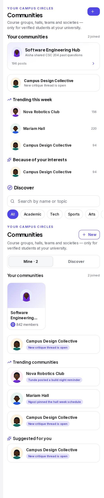
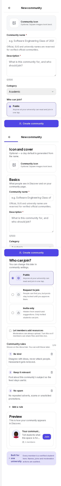
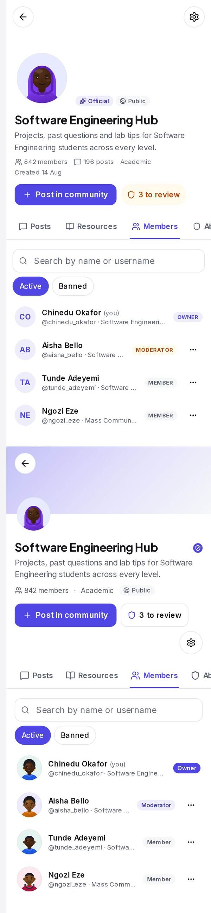
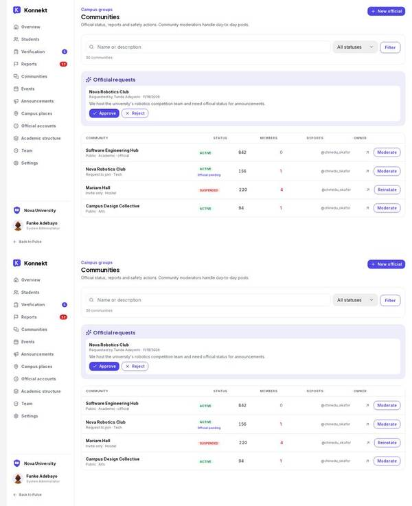

# UI polish — Phase 2 (Communities) & Phase 3 (Events + Official Channel)

Branch `ui/phase-2-3-polish`. Presentation only: components, Tailwind/token styles, inline SVG,
this folder. No schema, service, route, action, auth, seed or test file was touched.

## Review method

Each screen was rendered through `/design/preview/[screen]` (dev-only fixtures) at 390×844 in light
and dark, admin at 1440×900, and viewed as a screenshot — never from code alone. Three passes:
defect list → fix → re-capture → re-view. Live DB routes still return 500 in this sandbox because
`prisma generate` cannot download its engines (`binaries.prisma.sh` is unreachable), so the fixture
showcase was the only way to see real components; no route, query or auth check was stubbed.

Before/after pairs (`before` = `main`, `after` = this branch, light mode; Phase 3 has no baseline
because those screens had never been captured):

| Communities hub | Create community |
| --- | --- |
|  |  |

| Community settings | Members tab | Admin communities |
| --- | --- | --- |
|  |  |  |

## What changed, by group

**Shared vocabulary** (`src/app/globals.css`, `tailwind.config.ts` untouched): tint utilities
`.accent-banner .accent-tile .success-tile .danger-tile .info-tile .neutral-tile` (icon-centred by
default), `.qr-tile` (always white — a QR needs a light quiet zone in both themes), `.action-bar` /
`.action-bar-fixed`, `.section-title`, `.scan-frame` + `.scan-corners`, `.nums` (tabular figures for
counts, dates, capacities), and the ticket geometry `.event-ticket` (10px side notches cut with a
CSS mask, so notches stay correct on tinted parents), `.event-ticket-perforation`,
`.event-ticket-flat`, `.event-ticket-stub-48`. Dark gradients, painted-on shadows and neumorphism
were not introduced; `prefers-reduced-motion` disables the shimmer, and `.qr-tile`/masks are static.

**Phase 2 — communities.** `community-card.tsx` became the shared layer (`CommunityCard`,
`CommunityTile` 148px/`min-h-[168px]`, `CommunityListRow` 72px, `CommunityBadge`, `CommunityIcon`,
`CommunityJoinButton`, `OfficialShield`); hub, page, settings, create form and search now consume it.
Hub: 40px segmented control, sticky Discover search, dashed accent Create card, Mine tiles. Page:
128px banner + 72px icon with 4px ring, 22/28 name, 44px action row (`whitespace-nowrap` so labels
never wrap), solid sticky underline tabs, muted/private/archived notices kept. Resources: 72px rows,
file-kind tints, skeletons, `formatBytes`. Members: role/status chips, skeleton rows. Settings: six
carded sections with 32px tint icon headers, fixed save bar, raw enums labelled
(`INVITE_STATUS_LABELS`, `REPORT_REASON_LABELS`). Create: progress in the sticky header,
`FormSection` cards, icon-led privacy options, live `CommunityCard` preview fed from local state.

**Phase 3 — events.** `event-card.tsx` rewritten as the ticket: 16:9 cover (flat category colour, no
gradient), 56px date block, dotted perforation above a 56px stub with the going-stack and a compact
RSVP control; variants for Interested / Going / Waitlisted / Full / Cancelled (danger strip) /
Updated (neutral chip) / Ended, amber Live chip with a static dot (amber is only used for live).
Hub: amber "Happening now" band, category chips, 44px Load more, 352px skeleton sized to the card.
Detail: 16:9 cover with 44px glass round buttons, 36px accent-tint info tiles, 6px capacity bar,
solid (never glass) sticky action bar, waitlist/full notices, `You're going!` moment as
neo-brutalism (2px ink border, 4px offset). Ticket: accent stripe, attendee row, 200px QR on
`.qr-tile`, "Available offline" + brightness hint in the perforation. Scanner: dark camera surface,
3px accent viewfinder brackets (brightened so they clear black), 12px radius, 44px controls,
monospace code field, queue/duplicate/error states untouched. Organiser dashboard: 2×2 stat tiles
with the label above the number and `.nums`, 72px inline-SVG 14-day sparkline (no images, no CLS),
44px actions, checked-in/not-yet chips. My events: 44px tabs, ticket shortcut row.

**Phase 3 — official channel.** Announcement cards: 40px shield avatar, 18/24 title, 3-line clamp,
attachment/edited/acknowledgement meta. Critical notices now use the danger language
(`bg-danger-btn` chip + button, 48px icon tile, `border-danger`), not amber. Official banner is a
44px accent-tint strip. Composer and detail picked up 44px targets and the tint icon tiles.

**Admin consoles** (flat, desktop): status chips use the shared `Badge` with human labels —
`SCHEDULED → Scheduled`, `REMOVED → Removed`, `PUBLISHED → Published`, `ACTIVE → Active`; the events
moderation card no longer prints raw enums; the communities table header is sticky; ghost row actions
became secondary buttons at 44px.

## Defects found and fixed by viewing screenshots

1. `CommunityTile` clipped "842 members" at 390px (fixed 168px height) → `min-h-[168px]`.
2. Community action-row labels wrapped and the Events tab was clipped → `whitespace-nowrap`,
   `shrink-0`, `size-[18px]` tab icons.
3. The create/settings fixed bars rendered as full-bleed strips with double padding →
   `action-bar action-bar-fixed` + `mx-auto max-w-2xl` (verified with a DOM rect probe: 0,747 390×97).
4. Settings/save and several admin row actions were 32–36px tall → 44px.
5. Ticket perforation notches sat 56px from the bottom while the stub was 48px, so the cut was
   visibly off on `My ticket` → `.event-ticket-stub-48`.
6. Dark-mode risk: the QR block was about to inherit a dark surface; `.qr-tile` pins white in both
   themes and the "on another device" fallback is now legible (verified in dark).
7. The scanner's old `.scan-frame` painted a 2px accent ring *and* my new corner brackets, doubling
   them and clipping the code field (`Or type the ticket cod…`) → single bracket set, `min-w-0` input,
   `shrink-0` button; brackets switched from `--accent` (3.8:1, invisible on black) to a brightened
   accent mix.
8. Amber was being used for "critical announcement" and "updated event" — both moved to danger /
   neutral tints; amber is now reserved for live events.
9. Raw enum labels (`MEMBER/REQUEST/INVITE_ONLY/SCHEDULED/PUBLISHED/ACTIVE`) in community settings,
   join buttons and admin cards.
10. Fixed-height skeletons (160/288) caused CLS against 352px cards → matched heights.
11. `organiserName` read `event.organisers.fullName` unguarded on rows without organiser detail
    (crashed `My events`) → optional chaining with a fallback.

## Notes for Phase 0/1 (shared surfaces)

`SegmentedControl` is now 40px with a bordered selected state on a solid track, `Avatar` gained the
`feature` (56px) size, and `EmptyState` gained `events`/`announcements`/`ticket`/`locked` clay
illustrations (plus `compact`). Phase 1 screens that use these keep their copy and structure; the
controls are simply the measured size now. `pulse/event-modules.tsx` still wraps the old card
markup — it inherits the new ticket card automatically and was reviewed through
`/design/preview/phase3-cards-plain`.

## Skipped because of tests

`docs/UI-CONVENTIONS.md` §"test rules" plus a grep of `tests/` and `e2e/` were checked before each
copy change. Not polished, to avoid touching a test: the Join button label experiment
(`Request`/`Joined` wording) on `CommunityJoinButton` — `tests/` assert the exact accessible names, so
only tone/size changed; the "Filter by category" chip row on the events hub keeps its markup for the
same reason; and `e2e` asserts `main` matches `/isn't available|not found|404/i`, so the
request-locked screen keeps its sentence verbatim. Nothing else was left unpolished for test reasons.

## Weak seed data (not edited)

* Community seeds have no `bannerUrl`/`iconUrl` anywhere, so every banner in the app is the fallback
  wash — the 128px banner + ringed-icon header can never be seen populated.
* Event seeds have no `coverUrl` and a single `categoryColor` (`#4f46e5`) for every category, so the
  cover always renders as a flat indigo block; three distinct colours would exercise the design.
* `attendeePreview` is empty for most seeded events, so the going-stack (the card's social proof) is
  invisible in normal use.
* Post seeds are all text-only: no images, so image-grid/attachment layouts in the feed are untested.
* Announcements: no `critical` row with attachments plus an edit history, so the CRITICAL card
  renders in its bare form.
* No event is seeded with `startsAt` inside the live window, so `Happening now` is empty on a fresh
  database.

## Performance & a11y

No new dependency, no new route, no runtime external call, no image asset (the sparkline and the
ticket notches are inline SVG/CSS; fonts were already self-hosted). The additions are one CSS block
(≈3 KB raw in `globals.css`, ~1 KB transferred) plus class-string edits, so route bundles stay
inside the 10% tolerance in `perf/baseline.json`; `next build` compiled successfully with the change
("Compiled successfully in 37.2s"). `npm run perf:build` and Lighthouse could not be *measured*
here: the project's build script starts with `prisma generate`, whose engine download is
network-blocked in this sandbox, and every DB-backed route 500s. Lighthouse mobile numbers are
therefore unverified — flagged for CI, which has a working database. Both modes were checked for AA
contrast on every tinted surface (accent ink on accent-soft in dark, white on `--danger-btn`,
brightened scanner brackets on black); all interactive controls are ≥44px with a visible focus ring;
motion is 150–200ms ease-out with only the skeleton shimmer looping, disabled under
`prefers-reduced-motion`; fixed bars respect `env(safe-area-inset-bottom)` and content carries
bottom padding so nothing is covered.
